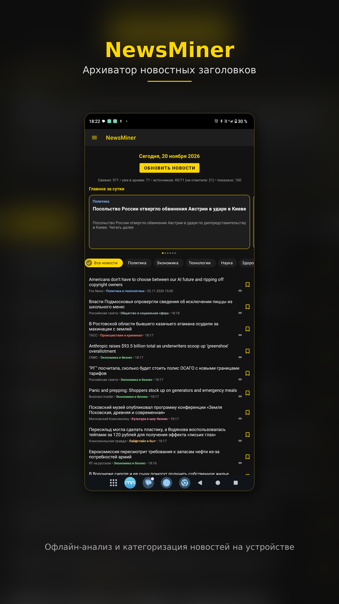
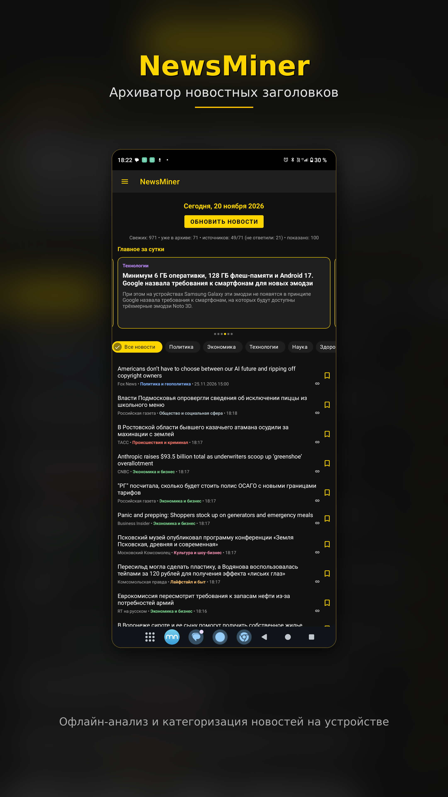
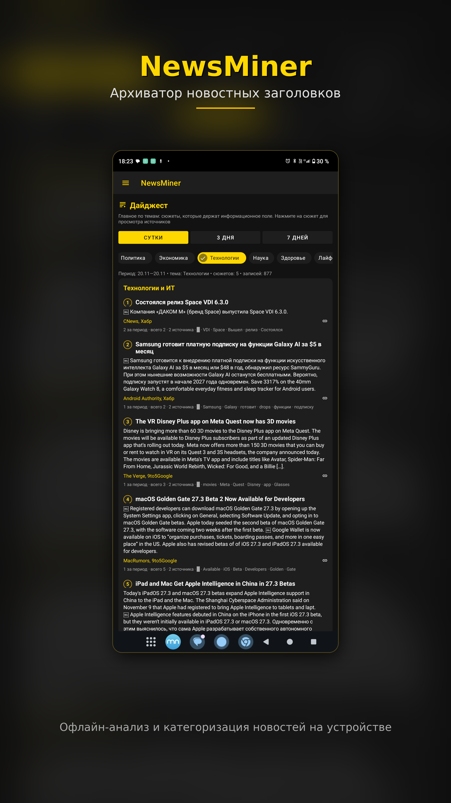

# NewsMiner — агрегатор новостных заголовков с локальной ML-моделью

Android-приложение, которое читает RSS-ленты новостных изданий, раскладывает
заголовки по темам **локальной нейросетевой моделью** — без обращения к серверам
и без интернета на этапе классификации — и строит поверх архива аналитику.

Это **описание проекта и достигнутых результатов**. Исходный код, веса модели,
датасет и собранное приложение не публикуются — см. раздел
«Что не опубликовано и почему».

---

## 1. Задача машинного обучения

Классификация новостного материала по **11 темам** (политика, экономика,
технологии, наука, здоровье, спорт, культура, происшествия, автомобили,
недвижимость, другое) с выполнением **на устройстве пользователя**: без сети,
без серверов, без передачи данных наружу.

Ограничение на инференс на телефоне задало требования к модели: она должна
работать офлайн, занимать приемлемый объём и выдавать результат за доли секунды
на массовом устройстве, а не на серверной видеокарте.

## 2. Результаты

Замер на **отложенной выборке из 903 примеров**, которые модель не видела
при обучении:

| Метрика | Значение |
|---|---|
| Accuracy | **85,2 %** |
| Macro-F1 | **0,778** |
| Согласие INT8-модели с FP32 | **99 %** |
| Размер модели после квантования | 179 МБ |
| Число классов | 11 |

Согласие INT8 с FP32 измерялось отдельно: квантование без потери качества —
не автоматический результат, а проверяемое свойство. Расхождение в 1 % означает,
что сжатие модели не сломало её поведение.

## 3. Как обучалась модель

- **База:** `DeepPavlov/rubert-base-cased`, дообучение под 11 классов.
- **Вход:** заголовок и описание, до 96 токенов. Часть описаний при обучении
  случайно отбрасывалась — чтобы модель работала и на источниках, где описания нет.
- **Три сида.** Модель обучалась трижды с разными начальными состояниями, лучшая
  выбиралась по macro-F1 на валидации. Один прогон даёт неустойчивый результат,
  три — воспроизводимый.
- **Псевдоразметка.** Неразмеченный пул новостей размечался текущей моделью
  и добавлялся в обучение: **+2 194 примера**. Отбор шёл по уверенности,
  разнице между топ-классами и энтропии распределения, с балансировкой классов.
- **Дисбаланс классов.** Веса классов и label smoothing — редкие темы иначе
  «съедаются» крупными, и macro-F1 падает при хорошем accuracy.

## 4. Инженерия вокруг модели

Модель — это половина работы. Вторая половина — то, что делает её пригодной
к использованию в приложении:

- **Собственный BERT-токенизатор на Kotlin.** Нормализация по `BertNormalizer`
  и WordPiece. Паритет с эталонной реализацией проверен на 44 случаях, включая
  неразрывный пробел, узкий NBSP, ZWSP и мягкий перенос — расхождение
  в токенизации даёт молчаливо неверные предсказания.
- **Контрактные тесты модели.** Проверяются словарь, входы и выходы ONNX-графа,
  а также совпадение инференса ONNX с результатами обучения. Тест ловит ситуацию,
  когда модель «загрузилась», но предсказывает ерунду.
- **Fallback на правила.** Если модель не поднялась, классификатор на словарях
  продолжает работать: приложение не остаётся без основной функции.
- **INT8-квантование** для уменьшения размера и ускорения инференса
  с проверкой деградации.

## 5. Что умеет приложение

| Раздел | Что показывает |
|---|---|
| Сегодня | лента новостей с фильтром по темам и блок «Главное за сутки» |
| Дайджест | главное по темам за сутки, 3 дня или неделю |
| Нарратив | как менялся сюжет: что вошло в поле, что ушло; марковские цепочки слов |
| Аналитика | статистика архива: источники, темы, языки, всплески |
| Закладки | отложенные материалы с фильтром по дате |
| Поиск | поиск по заголовку с подсветкой совпадений |

Источников — **71 RSS-лента**. Архив хранится локально в Room
(схема доведена до версии 5 с миграциями). Покрытие тестами —
**159 модульных тестов**, плюс скриптовые проверки моделей, миграций и SQL-запросов.

## 6. Приватность

- нет рекламных и аналитических SDK;
- персональные данные не собираются и не передаются;
- регистрации и входа нет;
- классификация выполняется на устройстве, тексты новостей никуда не отправляются;
- запрашиваются только разрешения, необходимые для работы.

## 7. Технологии

**Мобильная часть:** Kotlin, Android (minSdk 21, targetSdk 34), Room,
WorkManager, ONNX Runtime, ViewBinding, MVVM.

**Машинное обучение:** Python, PyTorch, transformers, ONNX / ONNX Runtime,
INT8-квантование, scikit-learn.

## 8. Что не опубликовано и почему

Проект — самостоятельная разработка. В открытом доступе его **нет**:

| Не публикуется | Причина |
|---|---|
| Веса модели (ONNX INT8, PyTorch Lite) | Основной результат обучения; модель — самостоятельная ценность |
| Датасет и словари | Результат разметки и балансировки |
| Исходный код приложения | Продуктовая разработка |
| Собранный APK | Готовый продукт |

Публичный репозиторий содержит только описание, архитектуру и результаты —
этого достаточно, чтобы оценить уровень работы, но не чтобы её воспроизвести
или присвоить.

## 9. Права

Все права защищены. Условия использования описаны в файле
[COPYRIGHT.md](COPYRIGHT.md). Копирование, распространение, переработка
и коммерческое использование материалов без письменного разрешения автора
не допускаются.

---

**Автор:** Александр Ковтуненко · [github.com/WiMean](https://github.com/WiMean)
